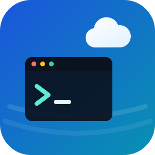
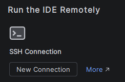
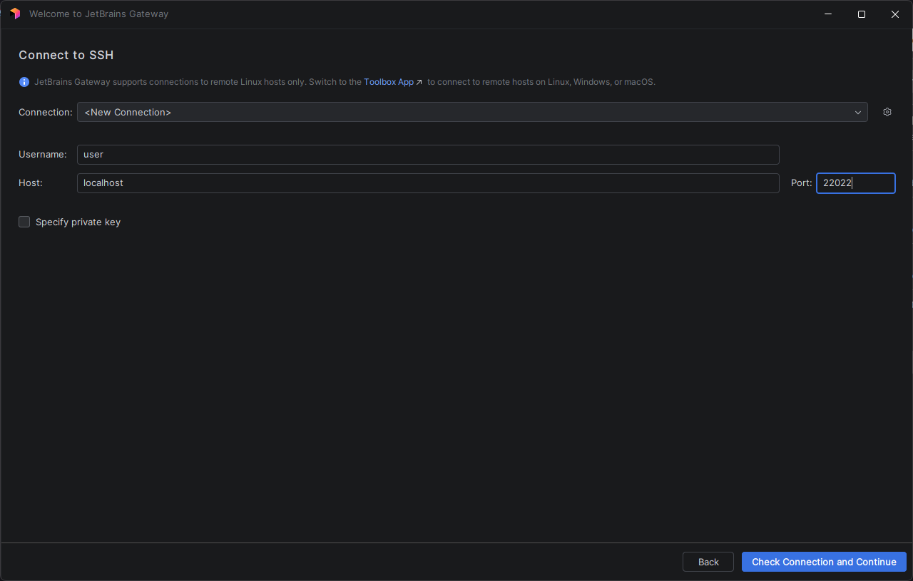
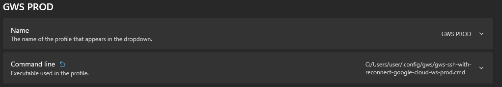
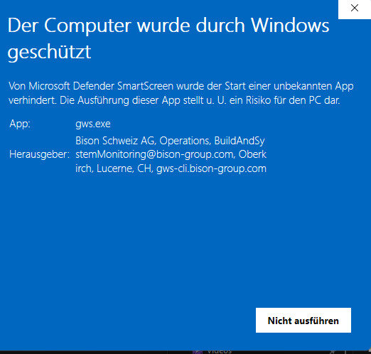
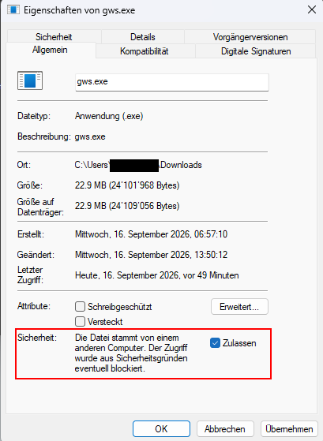

<div align="center">
  
</div>

# gws - Google Cloud Workstation CLI

A command-line tool to manage Google Cloud Workstations.

## Description

`gws` is a utility to simplify the management of Google Cloud Workstations. It provides commands to start, stop, and
connect to your workstation, as well as manage your configuration.

## Installation

You can install `gws` by downloading a binary from
the [latest release](https://github.com/BisonSchweizAG/gws-cli/releases/latest) or via Go using `go install`:

```bash
go install github.com/bisonschweizag/gws-cli@latest
```

## Usage

### Global Flags

Every command supports these global flags:

| Flag       | Description                                                           |
|------------|-----------------------------------------------------------------------|
| `--config` | Path to the configuration file (default: `~/.config/gws/config.yaml`) |
| `--ctx`    | The context to use instead of the current one                         |

### Commands

#### `gws setup`

Create or update `config.yaml` by running an interactive setup wizard.

```bash
gws setup
```

#### `gws start [context]`

Start the workstation for the given or current context.

```bash
gws start
gws start my-workstation
```

#### `gws stop [context]`

Stop the workstation for the given or current context.

```bash
gws stop
gws stop my-workstation
gws stop --all
```

| Flag    | Description            |
|---------|------------------------|
| `--all` | Stop all workstations  |

#### `gws restart [context]`

Restart the workstation for the given or current context.

```bash
gws restart
gws restart my-workstation
```

#### `gws status`

List all configured workstations with their current state. Alias: `st`.

```bash
gws status
gws status -o wide
gws status -o transpose
```

| Flag           | Description                          |
|----------------|--------------------------------------|
| `-o, --output` | Output format: `wide` or `transpose` |

#### `gws list`

List all cloud workstations in the current context. Aliases: `ls`, `ps`.

```bash
gws list
gws list -o wide
gws list -s name
gws list -f john
gws list -r
gws ps
```

| Flag            | Description                                                                                            |
|-----------------|--------------------------------------------------------------------------------------------------------|
| `-o, --output`  | Output format: `wide`                                                                                  |
| `-s, --sort`    | Sort by column: `name`, `user`, `project`, `config`, `state`, `last-started` (default: `last-started`) |
| `-f, --filter`  | Filter workstations by name or user (case-insensitive)                                                 |
| `-r, --running` | Show only running workstations (automatic when using `ps` alias)                                       |

#### `gws tunnel [context]`

Create an SSH tunnel to the workstation.

```bash
gws tunnel
gws tunnel my-workstation
gws tunnel -p 2222
gws tunnel --restart
```

| Flag                    | Description                                                       |
|-------------------------|-------------------------------------------------------------------|
| `-p, --local-host-port` | The local host port to open (default is the port from the config) |
| `--check-token`         | Enable periodic token check (default: `true`)                     |
| `--restart`             | Restart the workstation before opening the tunnel                 |

#### `gws launch [context]`

Open the default web URL of the cloud workstation in your browser.

```bash
gws launch
gws launch my-workstation
```

#### `gws up`

Upload files and directories to the workstation as defined in the context configuration.

```bash
gws up
gws up my-workstation
```

#### `gws down`

Download files and directories from the workstation as defined in the context configuration.

```bash
gws down
gws down my-workstation
```

#### `gws ctx [context]`

Switch the current context. If no context is provided, an interactive selection is shown.

```bash
gws ctx
gws ctx my-workstation
gws ctx --current
```

| Flag        | Description                       |
|-------------|-----------------------------------|
| `--current` | Print the current active context  |

#### `gws scripts win-reconnect-ssh [context]`

Generate a Windows SSH reconnect script.

```bash
gws scripts win-reconnect-ssh
gws scripts win-reconnect-ssh -s
gws scripts win-reconnect-ssh -o ./reconnect.bat
```

| Flag           | Description                                    |
|----------------|------------------------------------------------|
| `-o, --output` | Output file (default: stdout)                  |
| `-s, --save`   | Save the script to the default config location |

#### `gws scripts bash-reconnect-ssh [context]`

Generate a Bash SSH reconnect script.

```bash
gws scripts bash-reconnect-ssh
gws scripts bash-reconnect-ssh -s
gws scripts bash-reconnect-ssh -o ./reconnect.sh
```

| Flag           | Description                                    |
|----------------|------------------------------------------------|
| `-o, --output` | Output file (default: stdout)                  |
| `-s, --save`   | Save the script to the default config location |

#### `gws login`

Authenticate with Google Cloud using a simple text-based flow. This command prints an authorization URL to the terminal and waits for you to paste the authorization code. It does not require a browser or TUI, making it suitable for Termux and other headless environments.

```bash
gws login
```

#### `gws logout`

Log out and remove the stored Google access token.

```bash
gws logout
```

#### `gws update`

Update `gws` to the latest release from GitHub.

```bash
gws update
gws update --check
gws update --force
```

| Flag      | Description                                                                 |
|-----------|-----------------------------------------------------------------------------|
| `--check` | Only check whether a newer version is available                             |
| `--force` | Install the latest release even if it is not newer (or this is a dev build) |

## Configuration

`gws` is configured using a YAML file (default: `~/.config/gws/config.yaml`). You can use the `gws setup` command to
create an initial configuration.

The configuration file can contain multiple contexts. Each context defines the connection details for a specific
workstation.

### `config.yaml` example

```yaml
currentContext: my-workstation
contexts:
  my-workstation:
    host: localhost
    port: 2222
    user: user
    icon: 🏠
    privateKeyFile: /path/to/your/private/key
    knownHostsFile: /path/to/your/known_hosts
    postConnectCommand: # open 'GWS' profile in a new Windows Terminal Tab
      - 'wt'
      - '--window=0'
      - '--profile=GWS'
    gcloud:
      project: my-project
      account: user@example.com
      region: a-region
      cluster: my-cluster
      config: my-workstation-config
      name: my-workstation
    dirs:
      - path: /home/user/.ssh
        permissions: "0700"
    files:
      - sourcePath: /path/to/your/file
        path: /home/user/file
        permissions: "0644"
        direction: up
chromeBrowser:
  executablePath: C:\Program Files\Google\Chrome\Application\chrome.exe
  profileDirectory: Profile X
jetbrainsGateway:
  downloadDestination: C:\workspace\Jetbrains-Programs\JetBrainsClientDist
```

### Configuration Options

- `currentContext`: The name of the currently active context.
- `contexts`: A map of contexts.
    - `<context-name>`:
        - `host`: The hostname or IP address of the workstation.
        - `port`: The port to connect to.
        - `user`: The username to use for the SSH connection.
        - `icon`: Optional emoji displayed before the context name in the TUI and status output.
        - `privateKeyFile`: The path to the private key for the SSH connection.
        - `knownHostsFile`: The path to the known hosts file for the SSH connection.
        - `postConnectCommand`: Optional command and arguments to start after the tunnel is opened. The first item is
          the executable, and the remaining items are passed as arguments.
        - `gcloud`: The Google Cloud configuration.
            - `project`: The Google Cloud project.
            - `account`: The Google Cloud account (email, optional).
            - `region`: The Google Cloud region.
            - `cluster`: The Google Cloud cluster.
            - `config`: The workstation configuration.
            - `name`: The name of the workstation.
        - `dirs`: A list of directories to create on the workstation.
            - `path`: The path of the directory.
            - `permissions`: The permissions of the directory.
        - `files`: A list of files to upload to the workstation.
            - `sourcePath`: The path of the local file.
            - `path`: The path of the remote file.
            - `permissions`: The permissions of the remote file.
            - `direction`: The direction (up / down) the file is copied.
- `sshTimeoutSeconds`: Optional SSH connection timeout in seconds (default: `30`).
- `startTimeoutSeconds`: Optional workstation start timeout in seconds (default: `300`).
- `chromeBrowser`: Optional Chrome browser configuration.
    - `executablePath`: The path to the Chrome executable.
    - `profileDirectory`: The Chrome profile directory to use. (check profile dir by opening `chrome://version` in
      chrome)
- `jetbrainsGateway`: Optional JetBrains Gateway configuration.
    - `downloadDestination`: The directory where JetBrains programs are downloaded.
- `terminateOnShutdown`: If set to `true`, the TUI listens for real system shutdown events (not reboot) and automatically stops all workstations. On Linux, it uses D-Bus to detect systemd-logind shutdown signals. On macOS, it uses Darwin notifications to detect loginwindow shutdown events. On Windows, it uses SetConsoleCtrlHandler to detect system shutdown and user logoff events.

## Setup in JetBrains Gateway

1. Create a new SSH Connection  
   

2. Configure the SSH Connection

- Username: `user`
- Host: `localhost`
- Port: port configured for your gws context



## Integrate into Windows Terminal

1. Generate an SSH Start Script for Windows

The generated script automatically reconnects to the Workstation if the tunnel is re-opened.

```text
# dry run
gws scripts win-reconnect-ssh

# save the file to %HOME%\.config\gws\win-reconnect-ssh.bat
gws scripts win-reconnect-ssh -s
```

This saves a cmd file in `%HOME%\.config\gws\`.

2. Create a new Profile in Windows Terminal, giving it a name and select the cmd file as executable.
   

3. Configure the new profile in the postConnectCommand of your context in `%HOME%\.config\gws\config.yaml`.

```yaml
contexts:
  my-workstation:
    postConnectCommand: # open 'GWS PROD' profile in a new Windows Terminal Tab
      - 'wt'
      - '--window=0'
      - '--profile=GWS PROD'
```

## Windows SmartScreen

On some systems, Windows SmartScreen may block the execution of the gws.exe. To allow the gws to run, verify you have
downloaded it from this repository and verify the file is signed by gws certificate `gws-cli.bison-group.com`.



If this is the case, right-click on the gws.exe file and select `Properties` / `Eigenschaften`.

In the `Properties` / `Eigenschaften` dialog, click on the `Unblock` / `Zulassen` button.



## MacOS Binary Unlock

On some systems, MacOS may block the execution of the gws binary. To allow the gws to run, verify you have
downloaded it from this repository. Then you open a terminal and execute the following command, where ```gws``` is the full path to gws binary :

```sudo xattr -d com.apple.quarantine gws```